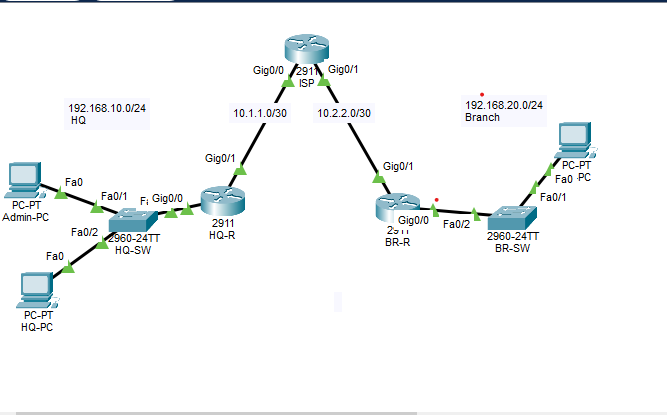
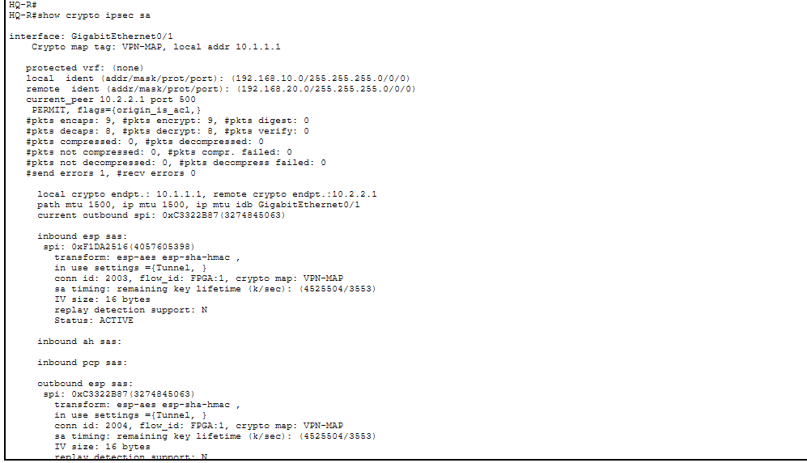
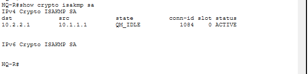
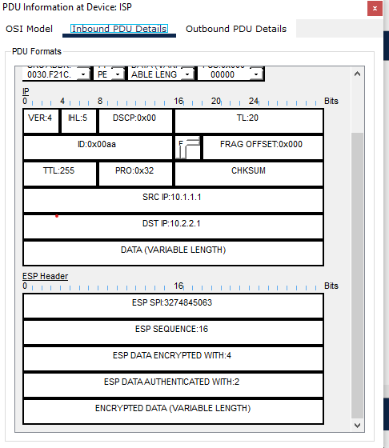
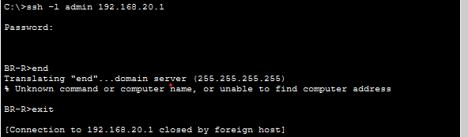
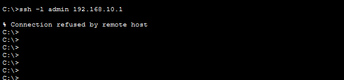
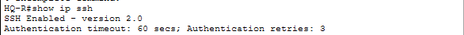

# Secure Remote Access Lab

Hands-on lab building a site-to-site IPsec VPN and hardened remote management, then a cloud remote-access VPN.

## Status
- [x] Part 1a: Site-to-site IPsec VPN (Cisco Packet Tracer)
- [x] Part 1b: SSH hardening and management ACLs
- [ ] Part 2: Remote-access VPN (Azure + WireGuard)

## Topology

| Device | Interface | IP address |
|---|---|---|
| HQ-R | Gi0/0 (LAN) | 192.168.10.1/24 |
| HQ-R | Gi0/1 (WAN) | 10.1.1.1/30 |
| ISP | Gi0/0 / Gi0/1 | 10.1.1.2/30 / 10.2.2.2/30 |
| BR-R | Gi0/1 (WAN) | 10.2.2.1/30 |
| BR-R | Gi0/0 (LAN) | 192.168.20.1/24 |

The ISP router has no routes to the private LANs, so traffic between sites only works through the encrypted tunnel.

## IPsec configuration
- **Phase 1 (IKE):** AES-256, SHA, pre-shared key, DH group 5
- **Phase 2 (IPsec):** ESP with AES and SHA-HMAC, tunnel mode
- **Interesting traffic:** 192.168.10.0/24 ↔ 192.168.20.0/24 (mirrored crypto ACLs)

Full configs are in [`configs/`](configs/).

## Verification
Tunnel established (`QM_IDLE`) with traffic encrypted and decrypted:

In Simulation mode, the ISP only sees ESP packets between 10.1.1.1 and 10.2.2.1, never the private addresses:

## Secure remote management

Both VPN routers are hardened so only the admin workstation (192.168.10.50) can manage them, and only over SSH.

- SSH version 2 only, with 2048-bit RSA keys; Telnet disabled (`transport input ssh`)
- Local AAA user with hashed secret; minimum password length of 10
- VTY access restricted with a standard ACL (`access-class 10 in`)
- Brute-force protection: logins blocked for 120 s after 3 failed attempts in 60 s
- Idle sessions time out after 5 minutes

| Test | Result |
|---|---|
| SSH from Admin-PC to HQ-R | ✅ Allowed |
| SSH from HQ-PC to HQ-R | ❌ Refused by ACL |
| Telnet from Admin-PC | ❌ Refused |
| SSH from Admin-PC to BR-R | ✅ Allowed, through the IPsec tunnel |

The branch router is managed remotely through the VPN: the SSH session from HQ travels encrypted across the ISP.

## Troubleshooting
I hit four issues while building this (license activation, missing config, a non-mirrored crypto ACL, and a miscabled WAN interface). See [TROUBLESHOOTING.md](TROUBLESHOOTING.md).

## Tools
Cisco Packet Tracer · Cisco IOS · Git
